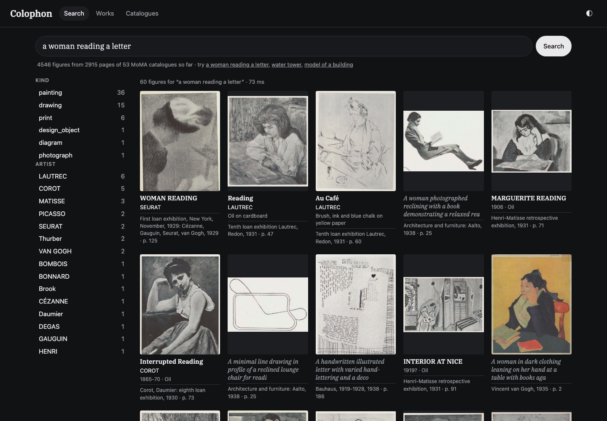
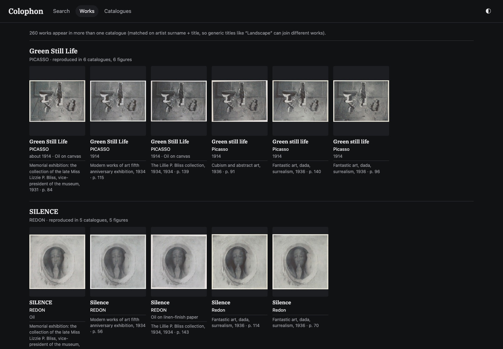
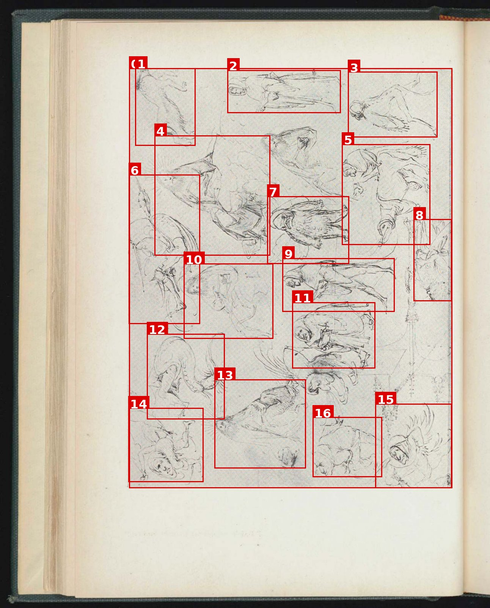
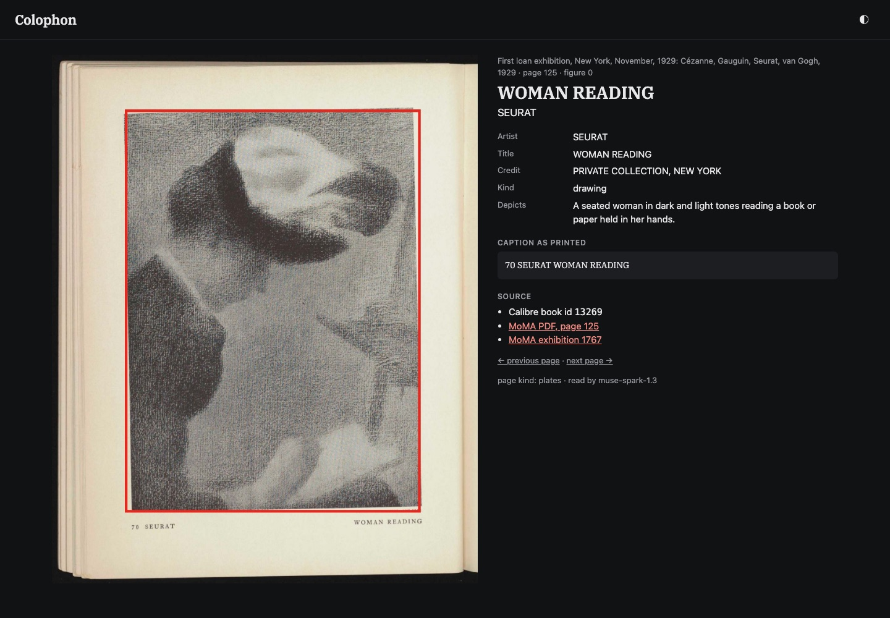

# Colophon

**A visual index and an identifier for a scanned library, built on Meta's SAM 3.1 and Muse Spark.**

Built for the Meta Global AI Developer Hackathon 2026 (October 26 – November 4), indie track, theme *Build for Your
World*, over 2–3 November. Demo video: *link added at submission* (made with the tooling in `demo/`). The live instance runs on the author's home network
(its page renders and crops take 45 GB), so the video and the screenshots below are the demo; everything needed to
rebuild it from MoMA's public PDFs is in this repository.

## The problem

A home library of about 9,000 scanned books sits in Calibre. A quarter of them carry no identifier at all, and of
those, two in five are PDFs with no text layer. No catalogue anywhere knows which pictures are inside any of them. A
reader who remembers "a Seurat drawing of a woman reading, in some 1920s catalogue" has no way to find it, and a
cataloguer who wants to know what a scan *is* has to open it and read the title page.

Colophon does both of those jobs the way an art librarian does them, with two Meta models:

- **The visual index.** SAM 3.1 segments every painting, photograph, drawing, print, sculpture, map, diagram and
  illustration on every page. Muse Spark then reads each page with its figures numbered and returns, for every
  figure, what it depicts and the printed caption split into artist, title, year, medium, dimensions and credit. The
  result is embedded and served as a search page: a query in plain words returns the figures, each linking to its
  page, its caption and its book; a *Works* view lines up the same work wherever it is reproduced across catalogues.
- **The identifier.** Muse Spark reads a book's title page, copyright page and last pages and returns a strict
  catalogue record: title, authors, editors, artists, publisher, place, year, ISBNs, series and number, language, the
  colophon line, with the page each field came from. Every ISBN is checksum-tested, and the record is marked
  *verified* only when Open Library's title for that ISBN matches the title read from the title page. Nothing is
  guessed: a field not printed on the pages comes back empty, with a note.

SAM 3.1 runs locally on the home GPU fleet (two DGX Sparks and an RTX 4090); Muse Spark runs through the Meta Model
API. Everything is Python: the standard library plus Pillow on the servers, torch and the `sam3` package on the
workers. The services are three small `http.server` processes and SQLite.

## What it did on the demo set

The demo set is the **757 out-of-print exhibition catalogues the Museum of Modern Art serves free as PDFs** (77,750
pages, published 1929–2016; `docs/demo-set.csv` lists them with their URLs). Every number, and how it was measured,
is in `docs/RESULTS.md`.

| stage | result |
|---|---|
| SAM 3.1 segmentation | all 77,750 pages in 5 h 12 min on three machines, 0 failures; **93,527 figures** on 48,961 pages |
| Muse Spark page reads | 2,915 pages read (the oldest 53 catalogues; capped by budget): **4,546 figures** with artist, title, year, medium and caption; $16.31 |
| search index | 4,546 figures in Qdrant; **260 works** found reproduced in two or more catalogues; a query answers in 55–85 ms |
| identifier, gold test on all 757 books | title **94 %** (75 % strict), year **90 %** (81 % strict), publisher **86 %**, author **85 %** (40 % strict), ISBN **92 %**; 169 records verified against Open Library; $23.21 |
| Meta Model API, total | **$39.52** of a $100 cap, held by three guards |

The *gold* is MoMA's own catalogue-record sheet, which is page 1 of every PDF; the identifier never saw it
(`--skip-first 1`). *Strict* is a plain comparison. *Convention-aware* accepts MoMA's cataloguing habits: the series
line folded into the title, the artist filed as the author of a brochure, the exhibition year in place of the print
year. The gap between the two columns is convention, not misreading; the strict numbers are the honest floor.

Three things the scores hide, all in `docs/RESULTS.md`: the gold itself has errors (one brochure MoMA dates 1987
carries a ©2005 line); one PDF holds two brochures; and most "missed" fields are pages where the imprint was not sent,
and the model said so instead of guessing.

### Screenshots



*Search in plain words. The hits are figures, each with the artist and title read from its printed caption, the
catalogue and the page. The facets are built from the hits.*



*Works: the same painting wherever MoMA reproduced it, matched on the artist's surname and the title read from the
captions. 260 works across the 53 catalogues read so far.*



*What the reader sends: the page with every figure SAM found drawn and numbered, 17 of them here. The model
answers with one record per number.*



*A hit opens its page with the figure outlined, the record Muse Spark read for it, and links to the PDF page at
moma.org and to the exhibition.*

## How it works

```
Calibre ─ books.json ─▶ render.py ─ pages/*.jpg + text/*.bbox.html ─▶ coordinator.py  (:8101, SQLite queue)
                                                                         ▲  lease / page / result   (docs/PROTOCOL.md)
                                                   worker_sam.py × 3 ────┘  SAM 3.1, 8 prompts, ~95 pages/min each
                                                                         │
                                                 postprocess.py ◀────────┘  merge · size · text · nesting → figures/, crops/
                                                                         │
      reader.py ─ Muse Spark, one call per page with figures ───────────▶ read/<book>/<page>.json
                                                                         │
      index.py ─ bge-m3 → Qdrant `colophon_figures` ────────────────────▶ serve.py (:8102)  search · works · catalogues · page

      identify.py ─ Muse Spark, one call per book ─▶ verify.py (ISBN checksum + Open Library title) ─▶ ident/<book>.json
      gold_moma.py ─ ident/ against Calibre's copy of MoMA's record ─▶ ident/_gold_summary.json
```

| piece | file | what it does |
|---|---|---|
| book list | `colophon/calibre_books.py` | every Calibre book with a `moma` identifier and a PDF → `books.json` |
| render | `colophon/render.py` | pages to JPEG (long side 2000 px) with `pdftoppm`; word boxes with `pdftotext -bbox-layout` |
| coordinator | `colophon/coordinator.py` | hands pages to workers (20-minute leases, retries), stores results, post-processes in the background |
| worker | `colophon/worker_sam.py` | SAM 3.1 Object Multiplex: one image embedding, one grounding decode per prompt, every box above 0.30 |
| post-processing | `colophon/postprocess.py` | IoU merge, 1 % / 85 % area rules with a full-bleed exception, text-line coverage, nesting; crops with a 2 % margin |
| reader | `colophon/reader.py`, `meta_client.py`, `schemas.py` | the page with numbered boxes → Muse Spark → strict JSON per figure; the budget checked before every call |
| index + search | `colophon/index.py`, `serve.py`, `static/` | bge-m3 embeddings (infinity) → Qdrant; a stdlib server; one HTML page, no framework |
| identifier | `colophon/identify.py`, `verify.py`, `gold_moma.py` | front and back matter → record → verification → the gold test |
| deploy | `deploy/<host>/` | systemd units, the worker installs for a DGX Spark and a Windows PC, the API job scripts and the spend guard |

Design choices worth knowing:

- **Workers never see the library.** They talk HTTP to the coordinator: lease pages, fetch JPEGs, post boxes. Any
  machine with a GPU and Python can join or leave mid-run; a page whose lease expires goes back to the queue. The
  three workers here were two Linux boxes with user units and a Windows gaming PC started over SSH.
- **Post-processing lives on the coordinator**, so a rule change re-runs over the stored detections without
  touching a GPU (`--reprocess all`, about 1,100 pages/min). Three rules were added that way after looking at
  overlays: the nesting rule, the 85 % cap and the full-bleed exception.
- **Muse Spark sees the page, not the crop.** One call per page, with every figure's box drawn and numbered, so it
  reads each caption in context and can tell a detail from a work. Strict JSON schemas (`response_format:
  json_schema`) make the output usable without parsing prose.
- **Verification is a title rule, not a checksum.** In an earlier project on this library, checksum-valid ISBNs were
  still wrong: an advert's ISBN in the back matter, a multi-volume set's ISBN on each volume. Only matching Open
  Library's title against the title page catches those, and `verified` is the only status allowed to write to a
  catalogue. The rule's precision was tested with hard negatives (`docs/IDENTIFIER.md`): one false positive in 215.
- **Every API call is budgeted from the files.** The reader sums every `cost_usd` already on disk before each call;
  an independent guard sums them again every five minutes and stops everything at $98; the key can be deleted. The
  file totals agreed with Meta's bill to within a dollar.

## Run it yourself

You need Python 3.12+, `poppler-utils` (`pdftoppm`, `pdftotext`, `pdfinfo`) and Pillow; a GPU machine for the
worker (torch, the `sam3` package and a SAM 3.1 checkpoint; `deploy/spark1/install.sh` is the recipe, and
`deploy/winbox/README.md` the Windows one); a Qdrant instance and an embedding server for bge-m3 (`infinity`
serves it); and a Meta Model API key.

```bash
# 1. the book list: from Calibre, or write books.json by hand from docs/demo-set.csv:
#    [{"id": 13269, "title": "…", "pdf": "/path/to.pdf", "pages": 157, "year": "1929", "moma": "1767", "moma_doc": "300061826"}, …]
python3 colophon/calibre_books.py --lib /path/to/calibre-library --ident moma --out /srv/colophon/books.json

# 2. render the pages and the text layers
python3 colophon/render.py --root /srv/colophon --jobs 12

# 3. the coordinator (keep it running), then one worker per GPU
python3 colophon/coordinator.py                                                 # :8101
python3 colophon/worker_sam.py --coordinator http://<host>:8101 --name gpu1 \
        --ckpt /path/sam3.1_multiplex_fp16.safetensors
curl -s http://<host>:8101/status | python3 -m json.tool                          # progress, per-worker rates, what was dropped

# 4. read the pages that have figures  (key in ~/.config/colophon/meta.env as META_API_KEY=…, chmod 600)
python3 colophon/reader.py --root /srv/colophon --workers 8 --budget-usd 20

# 5. index and serve
QDRANT_API_KEY=… COLOPHON_QDRANT_URL=http://<qdrant>:6333 COLOPHON_EMBED_URL=http://<infinity>:7997 \
  python3 colophon/index.py --root /srv/colophon --loop
python3 colophon/serve.py --root /srv/colophon --port 8102                       # then open http://<host>:8102

# 6. the identifier, and the gold test
python3 colophon/identify.py --root /srv/colophon --skip-first 1 --workers 4
python3 colophon/gold_moma.py --root /srv/colophon --gold ident/_gold.json      # or --lib on the Calibre host
```

Every script is idempotent: a page or book that has an output is skipped, so any step can be stopped and resumed.
The reader and the identifier also run without a Meta key against any OpenAI-compatible local endpoint
(`--provider local --base-url … --model …`); that is how the prompts were developed before the key existed.

On the author's hosts the services are systemd units (`deploy/hub/`), the Spark workers user units
(`deploy/spark1/`, `deploy/spark2/`), and the Windows worker a PowerShell start/stop pair over SSH
(`deploy/winbox/`). Each folder's README records what was installed, what was measured, and the traps hit.

## The demo set, and why MoMA

MoMA serves its out-of-print catalogues free and unlisted at
`https://www.moma.org/documents/moma_catalogue_<exhibition>_<document>.pdf`. There is no index page, so the set was
enumerated from the Wayback Machine's CDX index (794 URLs, 792 live). The 757 with a PDF in the author's Calibre
library are the demo set; `docs/demo-set.csv` lists each with its Calibre id, MoMA exhibition and document numbers,
year, page count, title, PDF URL and exhibition page. Rebuilding the set is `curl` over one column.

Two things make it a good test. The catalogues are **about pictures** (paintings, sculpture, photographs,
architecture, design) in every layout from a 1929 loan exhibition to a 2005 brochure, and many works are reproduced
in several of them, which is what the Works view is for. And **every PDF carries MoMA's own catalogue record as
page 1**: a ready-made gold standard for the identifier that the model can be kept from seeing.

## Limits

- **The index covers 53 of the 757 catalogues.** The reads were budgeted at $75 and paused at $16; the pipeline is
  complete and the queue is simply where it stopped. Reading all 48,961 pages with figures would cost about $275 at
  the measured $0.0056 per page.
- **Artist spellings vary with the captions** ("LAUTREC", "TOULOUSE-LAUTREC"), so the artist facet splits them;
  the Works key uses the surname, so those still join. Generic titles ("Landscape") join different works; the Works
  view shows the crops side by side so a person can tell.
- **SAM boxes the objects in an installation photograph, not the photograph**, and it boxes ornaments and rules on
  text pages too. The reader's `is_figure` and a size-based down-weighting in the ranking handle the second, not the
  first.
- **The identifier's verso finder needs a text layer.** An image-only scan gets the front/back window only, and a
  copyright page outside it is missed, with a note saying so. 544 of the 757 MoMA records have no ISBN to verify at
  all, and the publisher test is weak on this set because the publisher is almost always MoMA.
- **No authentication** on the coordinator or the search page. The data is MoMA's public catalogues on a private
  network; do not put private scans behind it as it is.
- **The gold has errors**, so the accuracy figures are a floor in one more way.

## Repository

```
colophon/            the package: render, coordinator, worker, post-processing, reader, index, serve, identify, verify, gold
colophon/static/     the search page (HTML, CSS, JS; IBM Plex Serif)
deploy/hub/         the coordinator, index and search units; the API job scripts and the spend guard
deploy/spark1/       the SAM worker on a DGX Spark (install.sh, user unit); deploy/spark2/ notes the differences
deploy/winbox/      the SAM worker on a Windows 11 PC (venv, start/stop/status over SSH, smoke test)
docs/PROTOCOL.md     the data layout and the coordinator ↔ worker contract
docs/SEARCH.md       the index, the ranking, the page, the API
docs/IDENTIFIER.md   the identifier, the verification rules and why, the gold test and the runs that shaped it
docs/RESULTS.md      every number on the demo set
docs/demo-set.csv    the 757 MoMA catalogues with their URLs
docs/DEMO.md         the three-minute demo: script, shot list, the exact queries and commands
demo/                how the demo video was made from the live instance (Playwright, Kokoro, ffmpeg)
```

No scans, page images, API keys or model weights are in the repository.

## Credits and licence

Code: MIT (`LICENSE`). Models: SAM 3.1 (Meta, under its own licence; the checkpoint used is the fp16 Object Multiplex
repack distributed with ComfyUI), Muse Spark 1.3 through the Meta Model API, BAAI bge-m3 for embeddings, Qdrant for
vectors. The catalogues are the Museum of Modern Art's, served by MoMA; records are checked against Open Library. The
typeface is IBM Plex Serif (SIL Open Font License). Built by Rodrigo Conde with Claude Code.
